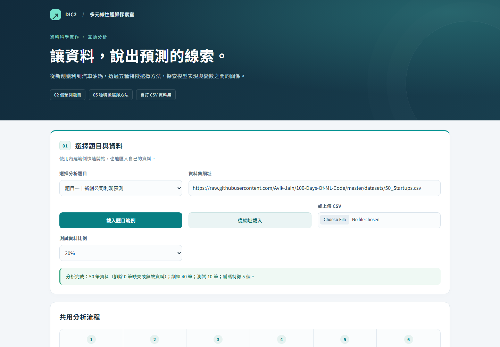
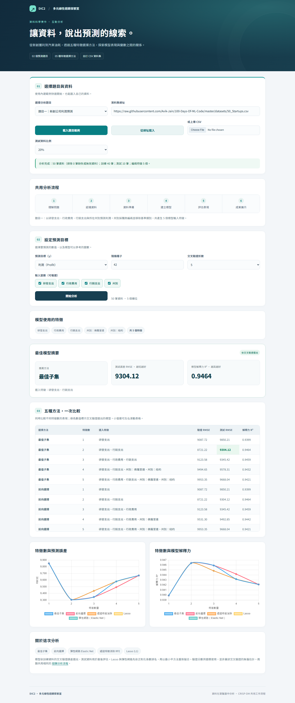
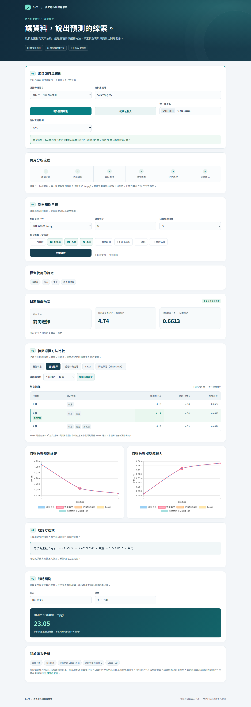
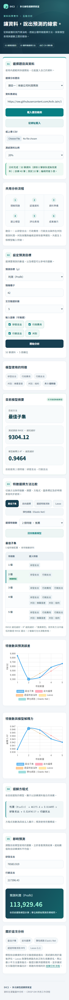

# DIC2｜多元線性迴歸探索室

以繁體中文呈現的互動式資料分析網站，透過兩個預測題目與五種特徵選擇方法，觀察輸入變數如何影響模型表現。

## 專案網址

- **網頁網址：** https://easyboy5566.github.io/DIC2/
- **程式碼網址：** https://github.com/EasyBoy5566/DIC2
- **主要程式：** [index.html](index.html)
- **共用工作流程：** [CRISP-DM 迴歸分析流程](workflows/regression.md)

## 網頁快照

以下快照於 **2026 年 10 月 14 日**從公開網站實際執行分析後擷取，並非設計示意圖。

### 桌面版首頁



### 題目一：新創公司利潤預測

以研發支出、行政費用、行銷支出與州別預測利潤。此題為預設展示與繳交主題。

[查看桌面版完整快照](docs/screenshots/startup-desktop.png)

<details>
<summary>展開題目一完整網頁</summary>



</details>

### 題目二：汽車油耗預測

以排氣量、馬力與車重預測每加侖行駛里程（mpg），直接套用同一個迴歸分析工作流程。

[查看題目二完整快照](docs/screenshots/mpg-desktop.png)

<details>
<summary>展開題目二完整網頁</summary>



</details>

### 手機版

採用單欄排列；比較表格可左右滑動。

<details>
<summary>展開手機版完整快照</summary>



</details>

## 作業要求對照

| 要求 | 實作內容 |
| --- | --- |
| 完成兩個 problem | 新創公司利潤預測、汽車油耗預測 |
| 選一個主題繳交 | 預設為題目一：新創公司利潤預測 |
| 下拉選單呈現兩題 | 可切換題目並載入對應範例 |
| 第二題套用 skill 或 workflow | 直接重用共用 CRISP-DM 迴歸流程 |
| 可自行輸入 Dataset | 支援公開 CSV 網址與本機 CSV 上傳 |
| 中文操作與成果展示 | 繁體中文介面、結果摘要、比較表格與互動圖表 |

## 使用方式

1. 開啟[網站](https://easyboy5566.github.io/DIC2/)，會自動載入 **50 Startups** 並顯示第一題的分析結果，無須先按按鈕。
2. 按下「載入題目範例」。也可以輸入 CSV 網址後按「從網址載入」，或上傳本機 CSV。
3. 確認預測目標、輸入變數、測試資料比例、隨機種子與交叉驗證折數。
4. 按下「開始分析」，在「特徵選擇方法比較」切換方法與特徵數，模型摘要、圖表標記、迴歸方程式及即時預測都會同步更新。預設顯示推薦模型，亦可按「回到推薦模型」還原。
5. 在「即時預測」調整數值或類別，即可查看目前模型的預測結果。只顯示該模型使用的原始變數；數值預填訓練資料平均值，類別預填基準類別。空白輸入會提示補齊，超出訓練資料範圍會標示外推。

公開 CSV 網址須允許跨來源存取（CORS）；若來源不支援，可下載後使用本機上傳。兩個範例資料集已包含在 repo 中。

## 分析方法與結果

比較最佳子集（Best Subset）、前向選擇（Forward Selection）、遞迴特徵消除（RFE）、Lasso 與彈性網路（Elastic Net）。

預設設定為隨機種子 42、20% 測試資料與 5 折交叉驗證：

| 題目 | 完整資料筆數 | 編碼特徵數 | 訓練／測試筆數 | 測試 RMSE |
| --- | ---: | ---: | --- | ---: |
| 新創公司利潤預測 | 50 | 5 | 40／10 | 9304.12 |
| 汽車油耗預測 | 392 | 3 | 314／78 | 4.74 |

兩題的目標單位不同，RMSE 不適合跨題直接比較。這些數值由程式運算產生，未直接套用示範圖片的結果。

- 依訓練資料的交叉驗證 RMSE 選擇最佳模型，測試資料用於最後評估。
- 排除所選欄位有缺失值或目標無效的資料列，至少需要 10 筆完整資料。
- 類別編碼依訓練資料建立；測試資料中的未知類別採基準編碼。
- Lasso 與彈性網路以正則化係數排名，再用最小平方法重新擬合所選特徵。交叉驗證分數供選模使用，並非巢狀交叉驗證的無偏估計。
- 為控制最佳子集的組合搜尋量，最多支援 10 個編碼特徵；超過時會提示調整，不會默默刪除特徵。
- 已加入模型連動選擇、迴歸方程式及即時預測。方程式顯示四捨五入係數，預測使用完整精度；尚未加入係數顯著性檢定、調整後 R²、MAE、F 統計量及殘差診斷表。

## 本機執行與驗證

在專案根目錄執行：

```bash
python -m http.server 8000
```

開啟 http://localhost:8000 。網站採用 HTML、CSS、JavaScript、Papa Parse 與 Chart.js，無須建置；前端套件存放於 `vendor/`，保留授權標頭。

安裝 Python Playwright 與 Chromium 後，可執行：

```bash
python tests/browser_check.py
python tests/capture_snapshots.py
```

第一個指令驗證本機網站的兩題運算、CSV 載入、錯誤輸入、線性資料、切換題目及手機版；第二個指令從公開網站擷取快照，儲存至 `docs/screenshots/`。

## 部署與資料來源

推送至 `main` 後，由 [GitHub Actions](https://github.com/EasyBoy5566/DIC2/actions) 執行 [Pages 工作流](.github/workflows/pages.yml)，發布至 GitHub Pages。

- [50 Startups 資料來源](https://github.com/Avik-Jain/100-Days-Of-ML-Code/blob/master/datasets/50_Startups.csv)
- [Auto MPG 資料來源](https://github.com/mwaskom/seaborn-data/blob/master/mpg.csv)
- [作業參考網站](https://huanchen1107.github.io/AIoT-DIC2-MultipleLR/)
